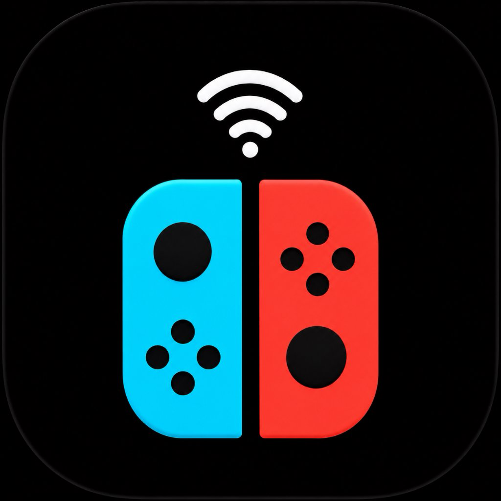
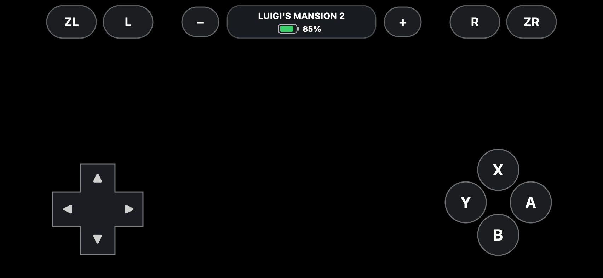

# NXremote 🎮
### *Ultra-Low Latency Virtual Nintendo Switch Controller for iOS*
**Created by demxxx**

[](LICENSE)
[](releases/)
[](ios_controller/)

---

<p align="center">
  
  <br>
  <em>Official NXremote Joy-Con Wireless Icon</em>
</p>

---

## 📸 Screenshots & Layout dell'App

<p align="center">
  
</p>

- **Metà Sinistra (Touch Dinamico)**: Tocca il vuoto a sinistra per muovere Luigi (`Stick L` - Movimento / `lx, ly`).
- **Metà Destra (Touch Dinamico)**: Tocca il vuoto a destra per controllare la **visuale / telecamera / mira Poltergust** (`Stick R` - Visuale / `rx, ry`).
- **D-Pad a croce Nintendo**: Classico ed ingrandito in basso a sinistra con frecce direzionali.
- **Tasti Azione ABXY**: Diamante Nintendo ergonomico in vetro satinato.
- **HUD Centrale**: Riconoscimento automatico del titolo in riproduzione (es. `LUIGI'S MANSION 2`) + percentuale e icona batteria stile iPhone.
- **Dorsali completi**: [ZL] e [L] a sinistra, [R] e [ZR] a destra, tasti [-] e [+], e supporto allo scuotimento fisico dell'iPhone (Shake!).

---

## ⚡ Caratteristiche Tecniche

- 🌐 **Multi-Network Auto-Discovery**:
  - **Subnet Auto-Scan**: Funziona su **qualsiasi rete Wi-Fi o Hotspot**, anche su reti dove Bonjour/mDNS è bloccato (Hotspot cellulare, reti isolate).
  - **Zero Configurazione**: Trova automaticamente il Mac ed il gioco in meno di 1 secondo.
- ⚡ **Zero Latency (60 Hz)**: Pacchetti binari ultra-compatti da 12-byte via WebSocket locale.
- 🛡️ **Compatibilità Totale Sideloading**: File Mach-O a 64-bit compilato con `LC_DYLD_INFO_ONLY` (zero fixup chains), pronto per **TrollStore**, **Feather**, **AltStore** e **SideStore**.

---

## 🕹️ Come implementare l'SDK in QUALSIASI gioco fatto con `nxnative`

L'SDK è drop-in: richiede solo **2 file** e **2 righe di codice C**:

### 1. File necessari (nella cartella `sdk/`):
- `switchpad_host.h`
- `switchpad_host.m`

### 2. Integrazione nel codice del gioco
Nel file principale del frontend del gioco (es. `front_mac.m` o `main.m`):

```c
#include "switchpad_host.h"
#include "dm_input.h" // Se usi l'engine nxnative / dm

// Callback invocato ad ogni pacchetto ricevuto dall'iPhone (60 Hz)
static void on_mobile_input(uint32_t buttons, int16_t lx, int16_t ly, int16_t rx, int16_t ry) {
    uint64_t full_mask = (uint64_t)(buttons & 0xffff);
    if (buttons & SWITCHPAD_BTN_SHAKE) {
        full_mask |= (1ULL << 32); // DM_BTN_SHAKE (Scuotimento)
    }
    
    // Inoltra direttamente al gioco (lx/ly muove Luigi, rx/ry orienta la visuale/torcia)
    dm_pad_set(full_mask, lx, ly, rx, ry);
}

// Nel main() o all'avvio del gioco:
int main(int argc, char **argv) {
    // 1 riga per avviare il server WebSocket e il broadcast mDNS/Bonjour:
    switchpad_host_start(8080, on_mobile_input);
    
    // ... loop normale del gioco ...
}
```

### 3. Per motori generici C / C++ o SDL2 (Polling continuo a frame)
Se il motore legge gli input in un ciclo continuo `while (running)`:

```c
#include "switchpad_host.h"

// All'avvio:
switchpad_host_start(8080, NULL);

// Nel Game Loop:
uint32_t buttons = 0;
int16_t lx = 0, ly = 0, rx = 0, ry = 0;
switchpad_host_get_state(&buttons, &lx, &ly, &rx, &ry);

if (buttons & SWITCHPAD_BTN_A) {
    // Tasto A premuto!
}
// lx, ly = Movimento stick sinistro
// rx, ry = Visuale / telecamera stick destro
```

---

## 📲 Installazione iOS (.IPA)

Scarica il pacchetto già compilato e pronto all'uso da [releases/NXremote.ipa](releases/NXremote.ipa):

- **TrollStore**: Apri il file `.ipa` e clicca **Install** (installazione permanente senza revocazioni).
- **Feather / Scarlet / ESign**: Firma direttamente sul dispositivo con il tuo certificato personale o d'impresa.
- **AltStore / SideStore**: Installa via sideloading standard collegando l'iPhone al Mac.

---

## 👤 Credits & Autore
- **Ideatore e Sviluppatore**: **demxxx**
- **Firma / Bundle ID**: `com.demxxx.nxremote`
- **Licenza**: MIT License
